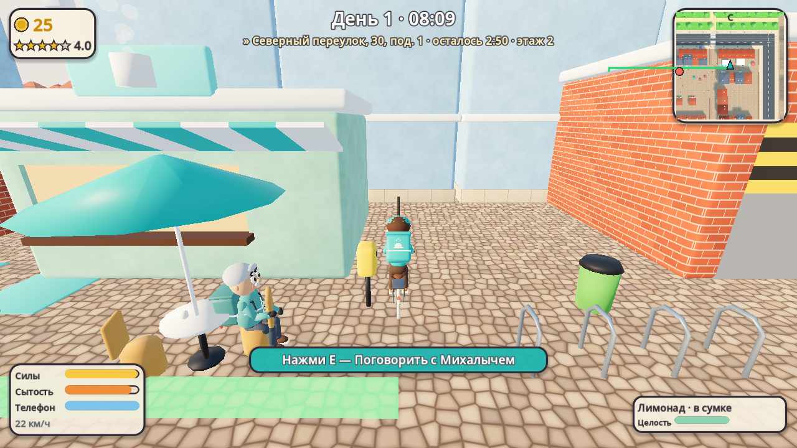

<div align="center">

# 🛵 Горячая сумка · Hot Bag

**A cartoon 3D food-courier sim made with Godot 4.7 — every model, texture, animation and level generated by Python in Blender.**

[](https://maxims.top/hotbag/)
[](https://github.com/msveshnikov/hot-bag/releases/latest)




</div>

Take orders in the «Хоп!» app, ride a squeaky bicycle (later an e-scooter, e-bike, e-moped or a tiny e-car) through a cartoon city, keep the pizza hot and the cake in one piece, climb stairs in houses without lifts, get past tower security, dodge police fines, tow trucks, rain, flat tyres, rival couriers and bike thieves — and open your dream restaurant. Russian UI. Four districts (Old Town, the business district «Сити», the sleeping district «Берёзки», the food quarter with the covered market and the Big Park), snow days, five chapters, a voiced mentor.

---

Мультяшный 3D-симулятор курьера доставки еды. Godot 4.7, все ассеты генерируются Python-скриптами в Blender 5.2
по пайплайну [claude-game-pipeline](https://github.com/msveshnikov/claude-game-pipeline).

- Дизайн-документ и промпты: [Горячая сумка — концепт-арт и задачи для Claude Code.md](Горячая%20сумка%20—%20концепт-арт%20и%20задачи%20для%20Claude%20Code.md)
- Решения и конвенции: [decisions.md](decisions.md)
- Задачи вертикального среза (Старый город): [task1](task1.md) → [task2](task2.md) → [task3](task3.md) →
  [task4](task4.md) → [task5](task5.md), по одной в новой сессии Claude Code.
- Прогон 2 (районы «Сити» и «Берёзки», главы 3–5, новый курьер): [run2.md](run2.md), отчёт — [report_run2.md](report_run2.md).
- Прогон 3 (снег, электровелосипед/мопед/электромобиль, Гастроквартал и Большой парк, мастерская, озвучка Михалыча):
  [run3.md](run3.md), отчёт — [report_run3.md](report_run3.md).

## Сюжет

1. **Первая смена** — Михалыч учит возить заказы (Старый город).
2. **Свой самокат** — накопить 300 монет.
3. **Деловой центр** — мост в «Сити»: башни с охраной и лифтами, обеденный пик, эвакуатор у входов.
4. **Ночные смены** — «Берёзки»: одинаковые панельки, «корпус 4», сломанные лифты, ночные надбавки.
   Заодно открывается **Гастроквартал и Большой парк**: крытый рынок, пельмени, рамен, гриль, блины, доставки к
   скамейкам в парке (на моторе туда нельзя), зимой — каток на пруду.
5. **Ресторан мечты** — 1000 монет и рейтинг 4,5 → своё помещение на Часовой площади → ужин для критика.

Сквозь главы идут **звания курьера** (опыт за доставки и квесты): Новичок → Курьер → Опытный курьер → Профи →
Мастер доставки → **Курьер-легенда**. Звания открывают электровелосипед, мопед и электромобиль, поднимают чаевые,
дают приоритет перед конкурентами, VIP-заказы с двойной оплатой и золотую термосумку. Есть задания дня и недели.
Каждый квест постоянного клиента дарит **подарок для ресторана** (рецепт бабушки Зины, котёл шефа Льва...): они
висят в зале и прибавляют ресторану дохода.

## Инструменты

- Blender 5.2: `C:\Program Files\Blender Foundation\Blender 5.2\blender.exe`
- Godot 4.7.2: `C:\Users\msves\OneDrive\Рабочий стол\Godot_v4.7.2-stable_win64.exe`

## Структура

```
concept/{locations,characters,empty,ui}   концепт-арт из ChatGPT (.gdignore)
concept_art/                              доп. референсы (.gdignore)
blender/scripts/                          генераторы (.gdignore)
assets/{architecture,props,characters,vehicles,textures,levels,ui,audio}
scripts/, scenes/                         игра
renders/                                  превью и скриншоты (.gdignore)
build/                                    сборки (.gdignore, не в git)
```

**▶ Играть в браузере (ПК и телефон): https://maxims.top/hotbag/** · **Android APK: https://maxims.top/hotbag/HotBag.apk**

**itch.io: https://extender777.itch.io/hot-bag** (веб, Windows, Android). Обновление: `butler push build/web extender777/hot-bag:html5`, `butler push build/windows extender777/hot-bag:windows`, `butler push <папка с apk> extender777/hot-bag:android` (+ `--userversion X.Y.Z`); butler лежит в `~/bin`.

## Управление

| Действие | Клавиатура / геймпад | Телефон |
|---|---|---|
| Движение | WASD / стрелки / левый стик | левый стик (дальше от центра — ускорение) |
| Ускорение / бег | Shift / RB | стик за кольцо |
| Тормоз | Пробел / B | «Тормоз» |
| Действие (забрать, доставить, поговорить) | E / A | «Действие» |
| Сесть / слезть | F / Y | «Сесть» |
| Телефон «Хоп!» | Tab или Q / Back | «Хоп!» |
| Позвонить клиенту | C / X | «Звонок» |
| Замок | L | «Замок» |
| Звонок велосипеда / гудок | R / LB | «Дзынь» |
| Предмет из сумки | X / D-pad вверх | «Сумка» |
| Камера | мышь, V — сброс / правый стик | свайп справа |
| Пауза | Esc / Start | «Меню» |

## Rebuild

`blender` = `C:\Program Files\Blender Foundation\Blender 5.2\blender.exe`, запускать из `blender/scripts`;
`godot` = `C:\Users\msves\OneDrive\Рабочий стол\Godot_v4.7.2-stable_win64.exe`.

```
python make_textures.py                                  # текстуры (numpy) -> assets/textures
python make_audio.py                                     # звуки и музыка -> assets/audio
blender -b --factory-startup -P build_architecture.py    # дома, башня, рестораны, база [-- --no-render | --only a,b]
blender -b --factory-startup -P build_props.py           # пропсы и еда
blender -b --factory-startup -P build_characters.py      # 12 персонажей + 40 анимаций [-- --only courier_m]
blender -b --factory-startup -P build_vehicles.py        # велосипед, самокат, машины, трамвай
python make_textures2.py                                 # текстуры прогона 2 (панели, плитка, стекло)
blender -b --factory-startup -P build_architecture2.py   # башни, фуд-корт, панельки, киоски, ресторан мечты
blender -b --factory-startup -P build_world.py           # Старый город: old_town_layout.json, ground, карта, рендеры
blender -b --factory-startup -P build_district.py -- --level city      # «Сити» (city_plan.py)
blender -b --factory-startup -P build_district.py -- --level berezki   # «Берёзки» (berezki_plan.py)
blender -b --factory-startup -P build_architecture3.py   # рынок, 4 ресторана, эстрада, ворота парка
blender -b --factory-startup -P build_district.py -- --level gastro    # Гастроквартал и парк (gastro_plan.py)
blender -b --factory-startup -P build_scene.py -- --level old_town|city|berezki|gastro --no-render  # население
python ../../tools/slice_icons.py                        # иконки мастерской из concept/ui/icon_sheet.png
python ../../tools/voice_lines.py [--missing]            # реплики Михалыча -> tools/voice_mikhalych.json
```

Порядок важен: текстуры → архитектура/пропсы → персонажи/транспорт → уровень → население. Потом в корне проекта:

```
godot --headless --path . --import
godot --path . -- --autotest               # прохождение + скриншоты renders/game/*.png и autotest.log
godot --path . -- --autotest --touch       # то же с сенсорным управлением
godot --path . -- --autotest --district city      # «Сити»: все адреса, охрана, лифты, эвакуатор, переезд
godot --path . -- --autotest --district berezki   # «Берёзки»: корпуса, сломанный лифт, квест, переезд
godot --path . -- --autotest --district gastro    # Гастроквартал: рынок, парк, мопед у ворот, снег, переезд
godot --path . -- --play --snow            # снежный день
godot --path . -- --tour x,z,yaw[,час] ... # скриншоты в точках
godot --path . -- --play [--newgame]       # сразу в игру
godot --headless --path . --export-release "Windows Desktop" build/windows/HotBag.exe
godot --headless --path . --export-release "Web" build/web/index.html
godot --headless --path . --export-debug "Android" build/android/HotBag.apk
scp build/web/* build/android/HotBag.apk ubuntu@severance.lol:/var/www/severance/6/
```

## Музыка

`assets/audio/music/*.mp3` — инструментальные треки из Suno (бесплатный план: только некоммерческое использование):
`music_menu` (главная тема, кафе-поп с аккордеоном), `music_day` и `music_day_2` (босса-свинг, чередуются),
`music_night` (лоу-фай джаз, с 20:00), `music_snow` (снежные дни, бубенцы и челеста). `Sfx.play_music` берёт mp3, а
если его нет — старый процедурный WAV; смена трека — плавная. Треки пережаты в 128 кбит/с с затуханием по краям,
чтобы петля не щёлкала. Музыка по умолчанию выключена (Настройки → Музыка).

## Промо-ролик

`renders/trailer/hot_bag_trailer_small.mp4` (~53 с), на YouTube: https://youtu.be/6r6PyO_7iiU (канал Manga TV, встроен в страницу itch.io). Сцены снимает сама игра: `--trailer <сцена>` в
`scripts/trailer.gd` (час, погода, транспорт, маршрут на автопилоте, движение камеры), запись — Godot Movie Maker.
`python tools/trailer.py record` → `sheet` (контактные листы) → `edit` (нарезка, подписи, голос диктора ElevenLabs
`renders/trailer/vo_full.mp3`, реплика Михалыча, музыка с приглушением под голос, финальная карточка `endcard.png`).

## Иконка

`concept/ui/app_icon.png` (ChatGPT) → `python tools/make_icons.py` → `icon.png` (окно, веб), `assets/icons/`
(Android: обычная 192 и адаптивная 432 — картинка целиком в безопасной зоне, фон — размытое продолжение;
Windows `.ico`; PWA 144/180/512). Пути прописаны в `export_presets.cfg`.

## Озвучка

Михалыч говорит голосом из `assets/audio/voice/mikhalych/<key>.mp3` (`Sfx.say`): ключ — md5 от букв реплики
(без цифр и знаков), поэтому подставленные числа не мешают. Список реплик с ключами и именами файлов —
`tools/voice_lines.py` → `tools/voice_mikhalych.json`; файлы озвучиваются в ElevenLabs (русский, пожилой добродушный
голос) и кладутся по пути `file`. Нет файла — реплика просто без голоса.

## Формат данных уровня (Godot: x, y, z; yaw — градусы вокруг Y)

- `old_town_layout.json`: `instances` (asset, gltf, group, pos, yaw, адрес для домов), `markers` (name, pos, yaw, inst), `streets`, `grid` (сетка 2 м; строка j = z0 − j·2; коды `# a s c p g t q w b z`), `heights`, `traffic` (пути, трамвай, переходы со светофорами), `water`, `kill_y`, `lighting` (пресеты), `map` (картинка + rect).
- `old_town_population.json`: `npcs` (модель, поведение, расписание), `cooks`, `mentor`, `police`, `rivals`, `thieves`, `traffic`, `fx`, `player`.
- `old_town_orders.json`: `restaurants` (меню, время готовки), `doors` (адреса), `regulars`, `quests`, `rules`.
- `old_town_events.json`: проблемы курьера с весами по главам.
- Районы прогона 2 — те же четыре файла `city_*.json`, `berezki_*.json`. В `layout` добавлен блок `district`
  (`title`, `exits` — зоны выезда с `to`, `entries` — точки появления по району, откуда приехал, `zones` — красные
  зоны «нет парковки»). В `orders.doors`: `kind` (house / panel / tower), `lift`, `corpus`, `plate_text`, `guard`;
  `orders.bignums` — большие номера на стенах. В `population`: `guards`, `mentor` = null вне Старого города.
